# 🚗 ROADBOOK: Берлин ➔ Барселона (Альпийский маршрут)

> **Формат**: Прикладной дорожный путеводитель.  
> **Концепция**: Максимум природы и альпийских видов. Минимум пустых перегонов.  
> **Язык топонимов**: Названия городов, замков и съездов даны на оригинальном языке (латинице) строго так, как они написаны на дорожных указателях и в навигаторе.

---

## 🧭 Общий план маршрута (5 дней • 2 054 км)

| Этап | Маршрут | Дистанция | Чистая езда | Главные ориентиры этапа |
| :---: | :--- | :---: | :---: | :--- |
| **1** | **Berlin ➔ Würzburg (Германия)** | **492 км** | **~5.0 ч** | Разгонный автобан A9, колосс в Leipzig, барочная резиденция и старый мост. |
| **2** | **Würzburg ➔ Lauterbrunnen (Швейцария)** | **534 км** | **~5.5 ч** | Средневековый Rothenburg, изумрудное озеро Thunersee, въезд в каньон скал. |
| **3** | **Lauterbrunnen ➔ Chamonix-Mont-Blanc (Франция)** | **244 км** | **~3.2 ч** | Водопад Staubbachfall, замок Gruyères, замок Chillon, подножие Mont Blanc. |
| **4** | **Chamonix ➔ Nîmes (Юг Франции)** | **392 км** | **~4.6 ч** | «Альпийская Венеция» Annecy, 49-метровый римский акведук Pont du Gard, арена. |
| **5** | **Nîmes ➔ Barcelona (Испания)** | **392 км** | **~4.2 ч** | Каталонский форт Salses, замок Дали в Figueres, финиш на холме Montjuïc. |

---

# ЭТАП 1: Berlin ➔ Würzburg
### *«Разгон на юг: от монумента Наполеону до мостов Франконии»*

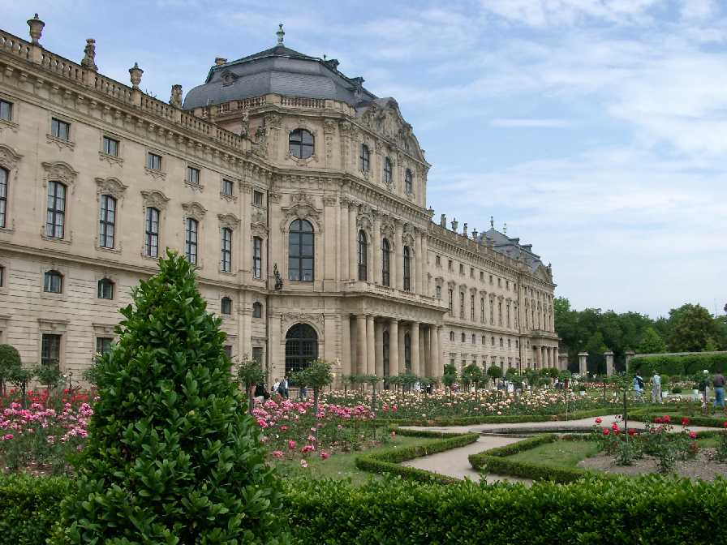

```
┌────────────────────────────────────────────────────────────────────────┐
│                          ПАСПОРТ ЭТАПА 1                               │
├──────────────────────┬─────────────────────────────────────────────────┤
│ Старт / Финиш        │ Berlin (Германия) ➔ Würzburg (Германия)         │
│ Дистанция            │ 492 км                                          │
│ Чистое время за рулем│ ~5 ч 00 мин                                     │
│ Трассы по знакам     │ A115 ➔ A9 ➔ A4 ➔ A7 ➔ A3                        │
│ Оплата / Дороги      │ Автобаны Германии (бесплатно, без ограничений)  │
│ Зимняя сложность     │ ЛЕГКАЯ (скоростные равнинные автобаны)          │
└──────────────────────┴─────────────────────────────────────────────────┘
```

### 🌲 Коротко о дне
Первый ходовой день. Задача — комфортно и без пробок проехать центральную Германию на юго-запад в сторону Альп. Дорога идет по широким скоростным автобанам A9 и A3. По пути — съезд к циклопическому 91-метровому памятнику Битве народов в Leipzig, а к вечеру — въезд в старинный Würzburg, окруженный холмами и виноградниками, с барочным дворцом ЮНЕСКО и вечерней прогулкой по мосту XV века.

---

### ⏱️ Почасовой ориентир дня

* **08:30** • Старт из Berlin с полной машиной, выезд на автобан A9 в южном направлении.
* **10:45 – 11:45** • **Чекпоинт 1: Völkerschlachtdenkmal (Leipzig)**. Съезд с A9 ровно на 10 минут. Осмотр колоссального гранитного храма-монумента, разминка ног и выгул собаки в парке.
* **11:45 – 14:30** • Переезд через Тюрингенский лес по трассе A4 и A7. Обед на трассе.
* **14:30** • Прибытие в **Würzburg**, заселение в отель, парковка машины.
* **15:00 – 16:30** • **Чекпоинт 2: Würzburger Residenz**. Дворец князей-епископов, парадная лестница с грандиозной потолочной фреской Тьеполо.
* **17:00 – Вечер** • **Чекпоинт 3: Alte Mainbrücke**. Пешеходная прогулка по древнему каменному мосту со статуями и панорамой крепости Festung Marienberg.

---

## 📍 Точки интереса и фотогалереи (День 1)

### 1. Völkerschlachtdenkmal (Leipzig)
`[СЪЕЗД С АВТОБАНА A9 НА 10 МИНУТ • 185 КМ ОТ СТАРТА]`

#### 📸 Галерея точки:
| Монумент снаружи (высота 91 м) | Внутренний зал славы (Kuppelhalle) |
| :---: | :---: |
| 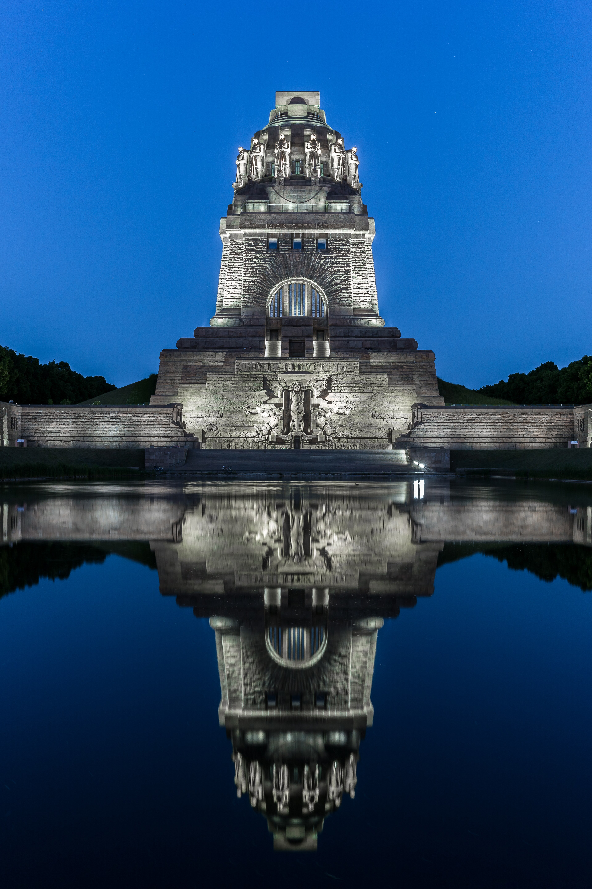 | 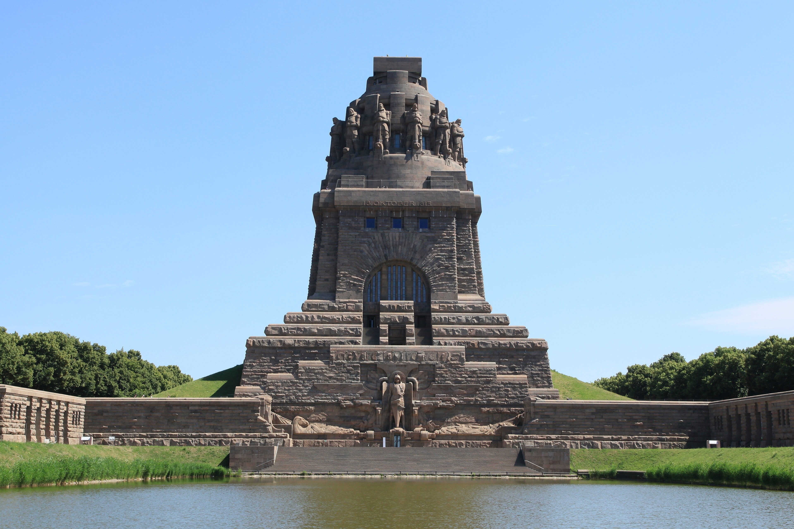 |

* **Что смотрим**: Колоссальный гранитный памятник высотой **91 метр** — самый массивный монумент в Европе (вес более 300 000 тонн). Перед ним раскинулся гигантский отражающий бассейн («Озеро слез»). Выглядит как циклопический храм древней цивилизации.
* **Масштаб**: Чтобы подняться на верхнюю смотровую площадку, нужно преодолеть 500 каменных ступеней. Внутри купола высечены исполинские фигуры воинов высотой почти 10 метров.
* **📜 Исторический факт**:
  > Построен ровно через 100 лет (в 1913 году) на месте крупнейшего сухопутного сражения мировой истории до Первой мировой войны — «Битвы народов» 1813 года. Здесь коалиция войск России, Пруссии, Австрии и Швеции наголову разбила полумиллионную армию Наполеона Бонапарта, решив исход войны.
* **🅿️ Парковка**: **Parkplatz Völkerschlachtdenkmal** (улица *Straße des 18. Oktober*). Большая бесплатная открытая парковка прямо у подножия. Вокруг монумента — огромный зеленый парк, идеальный для выгула собаки.
* **Время на остановку**: 45 минут.

---

### 2. Würzburger Residenz
`[ИСТОРИЧЕСКИЙ ЦЕНТР WÜRZBURG • ФИНИШ ДНЯ 1]`

#### 📸 Галерея точки:
| Главный фасад дворца (Residenzplatz) | Потолочный плафон Тьеполо (600 кв. м) |
| :---: | :---: |
|  | 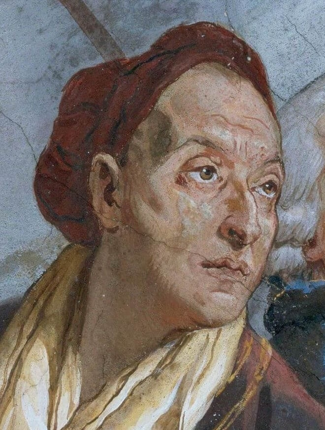 |

* **Что смотрим**: Дворец князей-епископов XVIII века, внесенный в список Всемирного наследия ЮНЕСКО. Считается одним из чистейших образцов южногерманского барокко.
* **Почему сносит крышу**: Парадная лестница (*Treppenhaus*) перекрыта грандиозным сводчатым сводом без единой опорной колонны. На своде написана **самая большая цельная потолочная фреска в мире** (площадь 600 кв. метров!) работы великого венецианского мастера Джованни Баттиста Тьеполо (1753 г.). На ней аллегорически изображены четыре известных тогда континента: Америка, Азия, Африка и Европа.
* **📜 Исторический факт**:
  > В марте 1945 года во время бомбардировки Вюрцбург был разрушен на 90%, дворец почти полностью сгорел. Однако гениальный каменный свод архитектора Бальтазара Неймана выдержал удар падающих балок и пламя, сохранив фреску Тьеполо в первозданном виде.
* **🅿️ Парковка**: Огромная размеченная парковочная площадь **Residenzplatz** прямо перед парадными воротами дворца.
* **Время на осмотр**: 1 час.

---

### 3. Alte Mainbrücke & Festung Marienberg
`[ПЕШЕХОДНАЯ ЗОНА WÜRZBURG]`

#### 📸 Галерея точки:
| Старый мост и крепость Marienberg на скале | Крепость Marienberg над виноградниками |
| :---: | :---: |
| 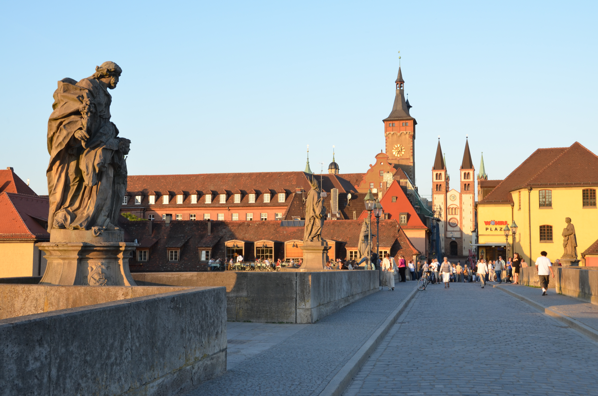 | 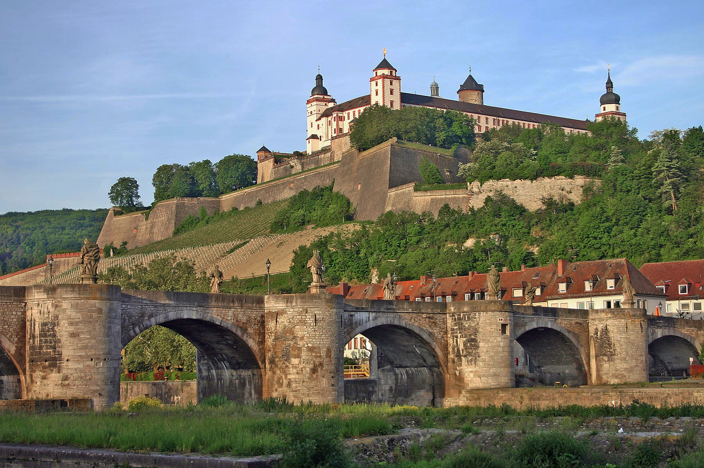 |

* **Что смотрим**: Древний каменный мост через реку Майн, построенный в 1476–1543 годах. По бокам моста установлены 12 барочных каменных статуй святых, королей и епископов (включая Карла Великого).
* **Вайб и атмосфера**: Прямо над противоположным берегом реки на высокой скале возвышается неприступная крепость **Festung Marienberg**, окруженная крутыми склонами виноградников. На закате мост наполняется местными жителями и туристами, которые покупают в прибрежных тавернах традиционный бокал вина (*Brückenschoppen*) и стоят на каменных парапетах, любуясь закатом над рекой.
* **🅿️ Ночевка и парковка в Würzburg**: Для безопасности машины с вещами выбираем отель с **подземным гаражом** (например, подземный охраняемый паркинг *Parkhaus Markt* или отель в тихом пригороде с закрытой частной территорией).

---

# ЭТАП 2: Würzburg ➔ Lauterbrunnen
### *«Из средневековой сказки прямо на дно ледникового каньона»*

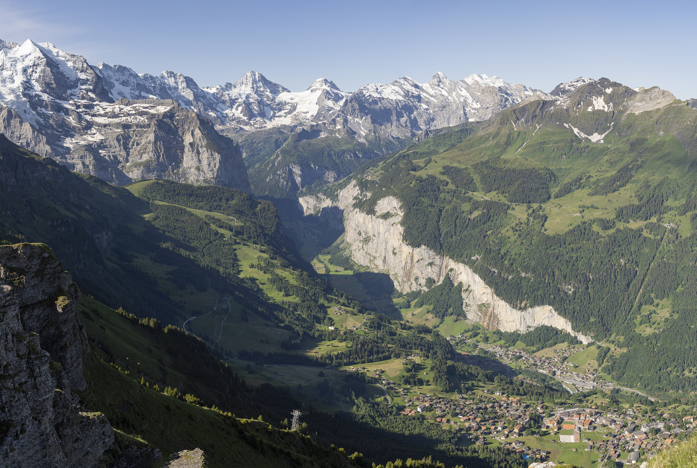

```
┌────────────────────────────────────────────────────────────────────────┐
│                          ПАСПОРТ ЭТАПА 2                               │
├──────────────────────┬─────────────────────────────────────────────────┤
│ Старт / Финиш        │ Würzburg (Германия) ➔ Lauterbrunnen (Швейцария) │
│ Дистанция            │ 534 км                                          │
│ Чистое время за рулем│ ~5 ч 30 мин                                     │
│ Трассы по знакам     │ A7 ➔ A81 (DE) ➔ A2 (Basel) ➔ A1 ➔ A6 ➔ A8 (CH)  │
│ Оплата / Документы   │ Швейцарская E-Vignette (оформлена онлайн)       │
│ Зимняя сложность     │ СРЕДНЯЯ (въезд в предгорья Альп, чищеные трассы)│
└──────────────────────┴─────────────────────────────────────────────────┘
```

### 🌲 Коротко о дне
Кульминационный день перехода из равнинной Германии в заснеженную горную Швейцарию. Утром — заезд в самый сохранившийся средневековый город Европы Rothenburg ob der Tauber (съезд с трассы всего на 10 минут). Затем — спокойный скоростной бросок через границу в Basel, проезд мимо столицы Bern и выезд к зеркальной глади озера Thunersee с панорамой замка Schloss Oberhofen. К 15:30 — триумфальный въезд прямо в ледниковый каньон Lauterbrunnen.

---

### ⏱️ Почасовой ориентир дня

* **08:30** • Выезд из Würzburg на юг по трассе A7.
* **09:15 – 10:45** • **Чекпоинт 4: Rothenburg ob der Tauber**. Съезд с автобана A7 ровно на 10 минут. Прогулка по средневековому городку внутри крепостных стен, подъем на башню, Plönlein.
* **10:45 – 13:30** • Переезд по скоростному автобану A81 к границе Швейцарии (Basel).
* **13:30** • Пересечение границы Швейцарии (пограничный пост Basel). *Транзит б/у личных вещей в Испанию*.
* **13:30 – 14:45** • Проезд по трассе A1/A6 мимо Bern к предгорьям Альп.
* **14:45 – 15:15** • **Чекпоинт 5: Schloss Oberhofen & Thunersee**. Остановка на набережной озера Thunersee: замок на воде на фоне гигантов Эйгер и Юнгфрау.
* **15:45** • Въезд в долину **Lauterbrunnen**. Заселение в шале, постановка машины в крытый паркинг *Parkhaus Lauterbrunnen*.
* **16:00 – 18:00** • **Чекпоинт 6: Staubbachfall**. Прогулка по деревне под 300-метровым замерзающим водопадом в лучах заката.

---

## 📍 Точки интереса и фотогалереи (День 2)

### 4. Rothenburg ob der Tauber
`[СЪЕЗД С ТРАССЫ A7 НА 10 МИНУТ • 65 КМ ОТ WÜRZBURG]`

#### 📸 Галерея точки:
| Знаменитый открыточный перекресток Plönlein | Крытая галерея крепостной стены (Stadtmauer) |
| :---: | :---: |
| 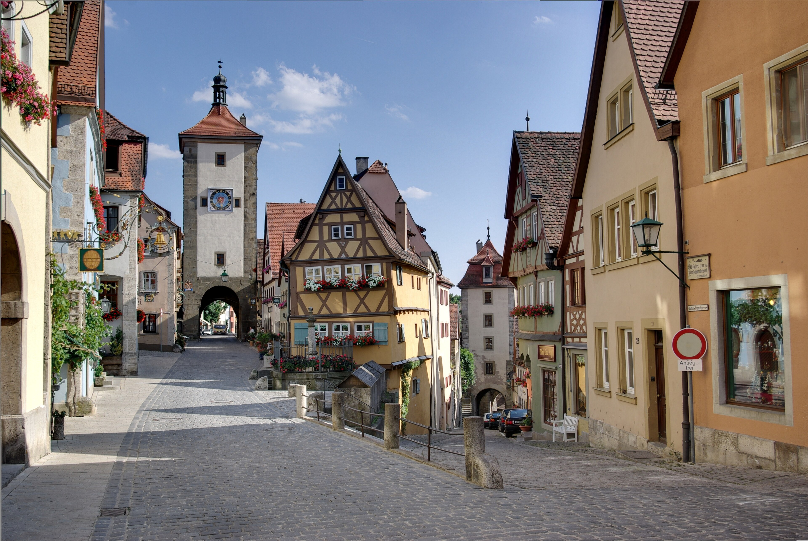 | 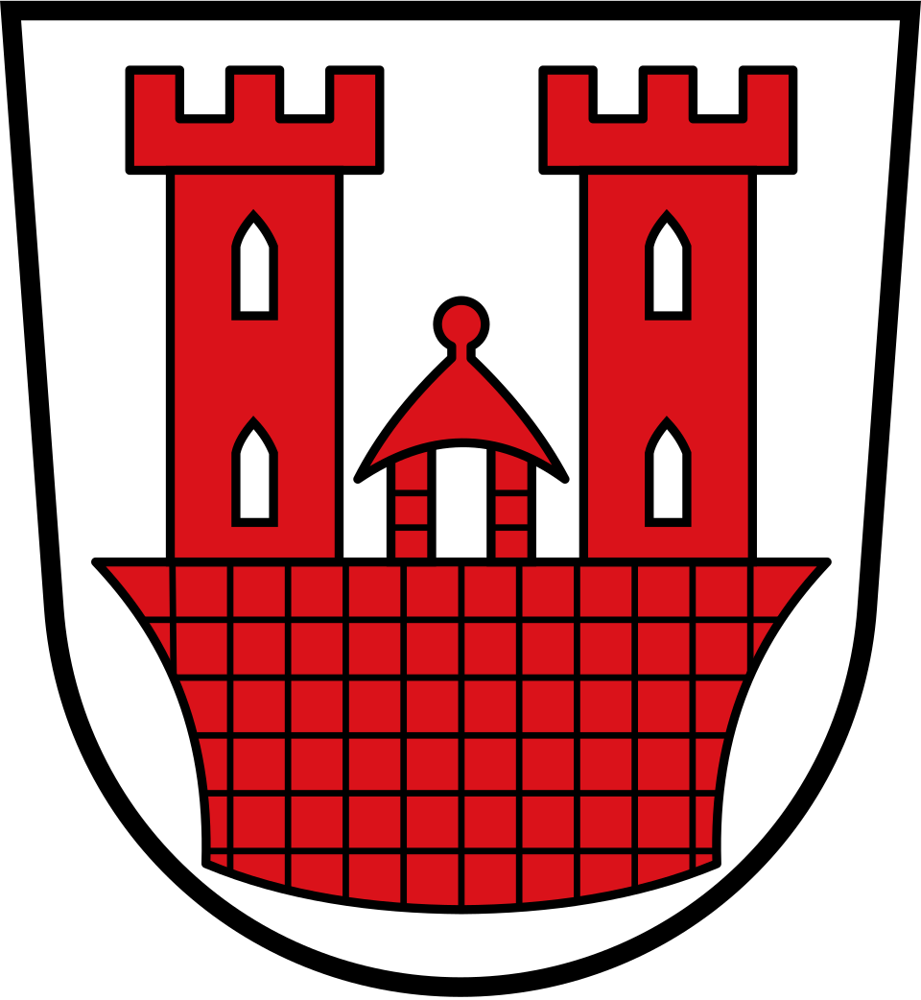 |

* **Что смотрим**: Абсолютно нетронутый средневековый имперский город. Он полностью окружен мощной каменной стеной XIV века с 42 боевыми башнями и глубоким рвом. Внутри города запрещены современные вывески, билборды и асфальт — только мощеные мостовые, кованые фонари и разноцветные фахверковые дома.
* **Что обязательно сделать**:
  1. Дойти до перекрестка **Plönlein** (на фото слева) — самого узнаваемого средневекового вида Европы с узким желтым домиком и двумя башнями ворот.
  2. Подняться на каменную крепостную стену (*Stadtmauer*): по крытой деревянной галерее можно пройти почти километр над крышами города.
* **📜 Исторический факт**:
  > В 1631 году во время Тридцатилетней войны католическая армия фельдмаршала Тилли захватила протестантский Ротенбург и собиралась сжечь его дотла. Ради шутки Тилли пообещал пощадить город, если кто-то из членов совета сможет выпить залпом огромный кубок вина емкостью 3.25 литра. 70-летний бывший бургомистр Георг Нуш принял вызов, осушил кубок за один глоток и спас Ротенбург. Это событие вошло в историю как «Мастерский глоток» (*Der Meistertrunk*).
* **🅿️ Парковка**: **Parkplatz P4 (Bezoldweg)** или **Parkplatz P5**. Расположены прямо перед крепостными воротами. Оплата картой.
* **Время на остановку**: 1.5 часа.

---

### 5. Schloss Oberhofen & Thunersee
`[ТРАССА A8 НА ПОДЪЕЗДЕ К ИНТЕРЛАКЕНУ • 485 КМ]`

#### 📸 Галерея точки:
| Замок Oberhofen прямо в воде озера | Панорама озера Thunersee и Альп |
| :---: | :---: |
| 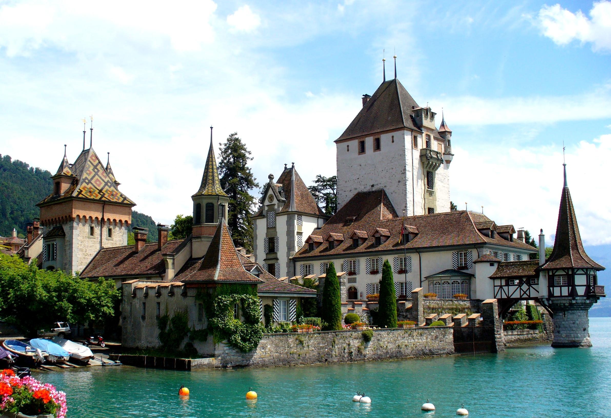 | 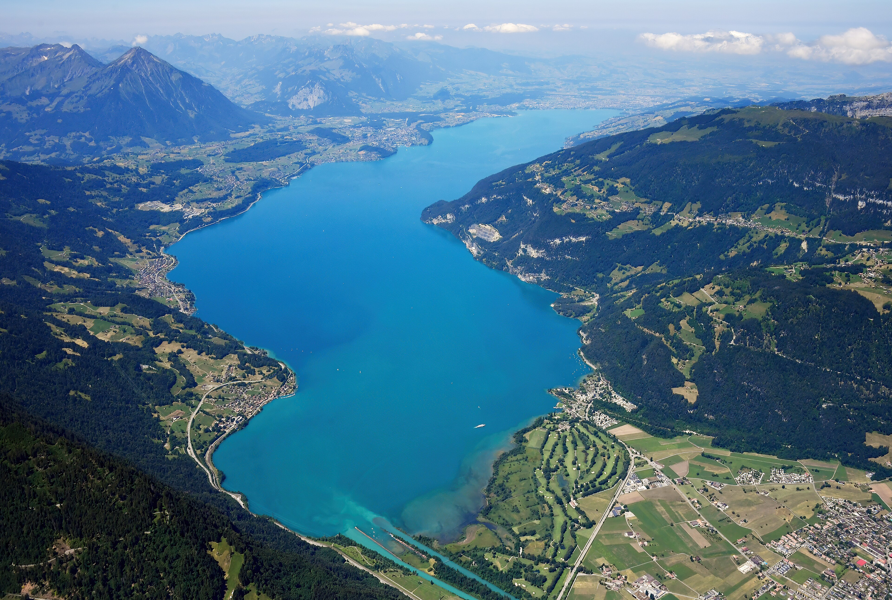 |

* **Что смотрим**: Сказочный замок XII века, чья изящная барочная башенка вырастает прямо из зеркальной глади озера Thunersee. Вода в озере имеет чистейший изумрудно-бирюзовый ледниковый оттенок.
* **Почему сносит крышу**: Прямо позади замка и озера вырастает исполинская снежная стена Бернских Альп с четырехтысячниками Эйгер, Мёнх и Юнгфрау. Это первая точка на маршруте, где Альпы предстают во всей своей гигантской мощи.
* **🅿️ Парковка**: **Parkplatz Schloss Oberhofen** прямо вдоль набережной.
* **Время на остановку**: 30 минут (размять ноги, сделать панорамные фото замка над водой).

---

### 6. Lauterbrunnen & Staubbachfall
`[ФИНИШНАЯ ТОЧКА ДНЯ 2 • ВЫСОТА 795 М]`

#### 📸 Галерея точки:
| Заснеженная долина каньона Lauterbrunnen | Водопад Staubbachfall (297 м) над церковью |
| :---: | :---: |
|  | 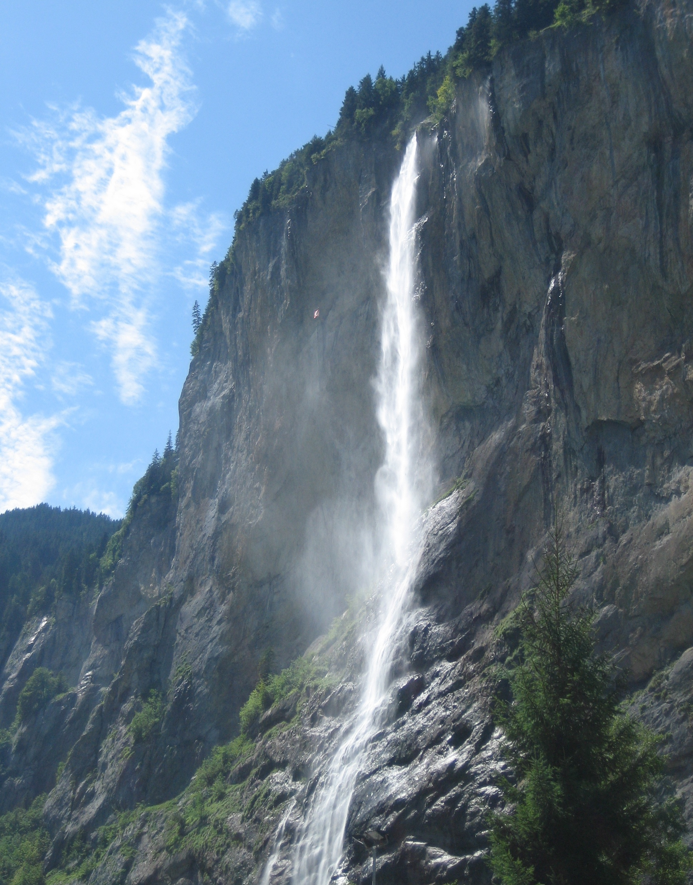 |

* **Что смотрим**: Дно ледникового каньона, зажатого между двух вертикальных монолитных скальных стен высотой 1 000 метров. Водопад **Staubbachfall** падает на 297 метров с отвесного уступа прямо за деревянной церковью.
* **Зимой**: Поток частично замерзает, превращаясь в причудливую ледяную колонну цвета аквамарина. Снег на крышах шале, морозный чистый воздух.
* **Прототип Ривенделла**: Долина, вдохновившая Толкина в 1911 году на создание эльфийского убежища во «Властелине Колец».
* **🅿️ Парковка**: **Parkhaus Lauterbrunnen** (крытый многоуровневый охраняемый паркинг у вокзала при въезде в деревню) — идеальная безопасность для машины с вещами при ночевке.
* **Вечер**: Заселение в традиционное деревянное шале, тишина спящей альпийской долины.

---

# ЭТАП 3: Lauterbrunnen ➔ Chamonix-Mont-Blanc
### *«Из долины эльфов к вечным ледникам Монблана»*

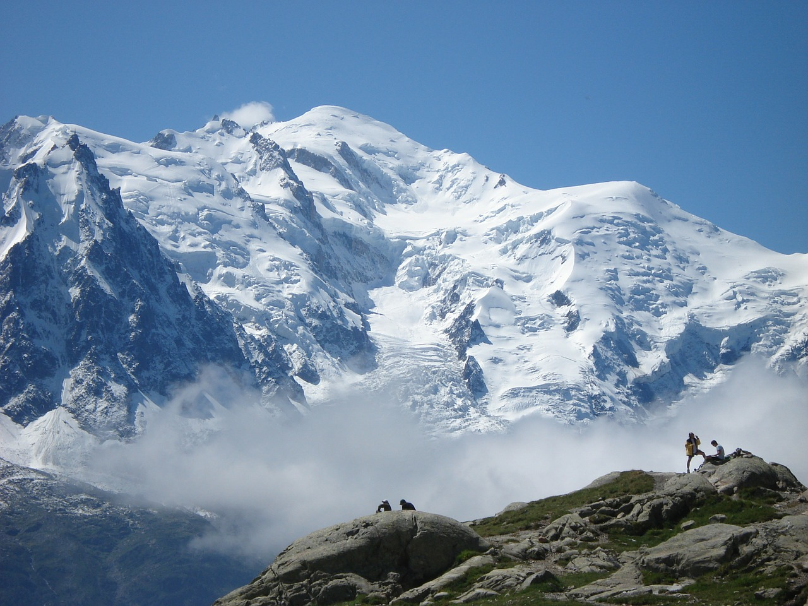

```
┌────────────────────────────────────────────────────────────────────────┐
│                          ПАСПОРТ ЭТАПА 3                               │
├──────────────────────┬─────────────────────────────────────────────────┤
│ Старт / Финиш        │ Lauterbrunnen (CH, 795 м) ➔ Chamonix (FR, 1035 м)│
│ Базовая дистанция    │ 244 км (через Женевское озеро и A40)            │
│ Горный вариант       │ 172 км (через перевал Col de la Forclaz)        │
│ Чистое время за рулем│ 3 ч 15 мин (базовый) / 2 ч 45 мин (перевал)     │
│ Трассы по знакам     │ A8 ➔ A6 ➔ A12 ➔ A9 (CH) ➔ A40 (FR)              │
│ Оплата / Документы   │ Швейцарская E-Vignette + шлагбаум A40 (~6 €)    │
│ Зимняя сложность     │ ЛЕГКАЯ (по автобану) / СРЕДНЯЯ (через перевал)  │
└──────────────────────┴─────────────────────────────────────────────────┘
```

### 🌲 Коротко о дне
Самый короткий по километражу, но самый насыщенный по визуальному масштабу день всего путешествия. Утром вы гуляете по дну ледникового каньона под 300-метровым отвесным водопадом, днем огибаете Женевское озеро с видом на заснеженные Альпы, заезжаете в средневековый замок Gruyères на фондю, а к 15:00 уже въезжаете в легендарную столицу европейского альпинизма у подножия Mont Blanc. За счет короткого перегона (всего 3 часа за рулем) день проходит без малейшей спешки.

---

### ⏱️ Почасовой ориентир дня

* **08:30 – 10:30** • Утренняя прогулка по Lauterbrunnen к Staubbachfall: водопад, деревянные шале, вид на стену Юнгфрау.
* **10:30** • Выезд из Lauterbrunnen по трассе A8 вдоль озера Thunersee.
* **11:45 – 13:15** • **Чекпоинт 7: Château de Gruyères**. Съезд с A12 на 5 минут. Обед (традиционное фондю Moitié-Moitié), средневековые стены и музей H.R. Giger.
* **13:45 – 14:30** • **Чекпоинт 8: Château de Chillon & Montreux**. Замок на воде Lac Léman, автограф Байрона на колонне, пальмы на фоне снежных Альп.
* **14:30 – 15:45** • Переезд вдоль озера и въезд во Францию по скоростной *Autoroute Blanche (A40)*.
* **15:45** • Въезд в **Chamonix-Mont-Blanc**, постановка машины в охраняемый подземный гараж *Parking Saint-Michel*.
* **16:00 – Вечер** • **Чекпоинт 9: Mont Blanc (4 808 м)**. 3 часа светлого времени у подножия Монблана и ледника Bossons, ужин с савойским Tartiflette.

---

## 📍 Точки интереса и фотогалереи (День 3)

### 7. Château de Gruyères
`[СЪЕЗД С ТРАССЫ A12 НА 5 МИНУТ (BULLE) • 105 КМ]`

#### 📸 Галерея точки:
| Замок Gruyères на вершине холма | Швейцарское фондю Moitié-Moitié | Бар создателя «Чужого» H.R. Giger |
| :---: | :---: | :---: |
| 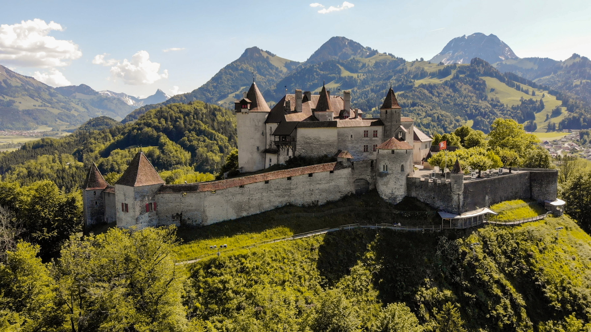 | 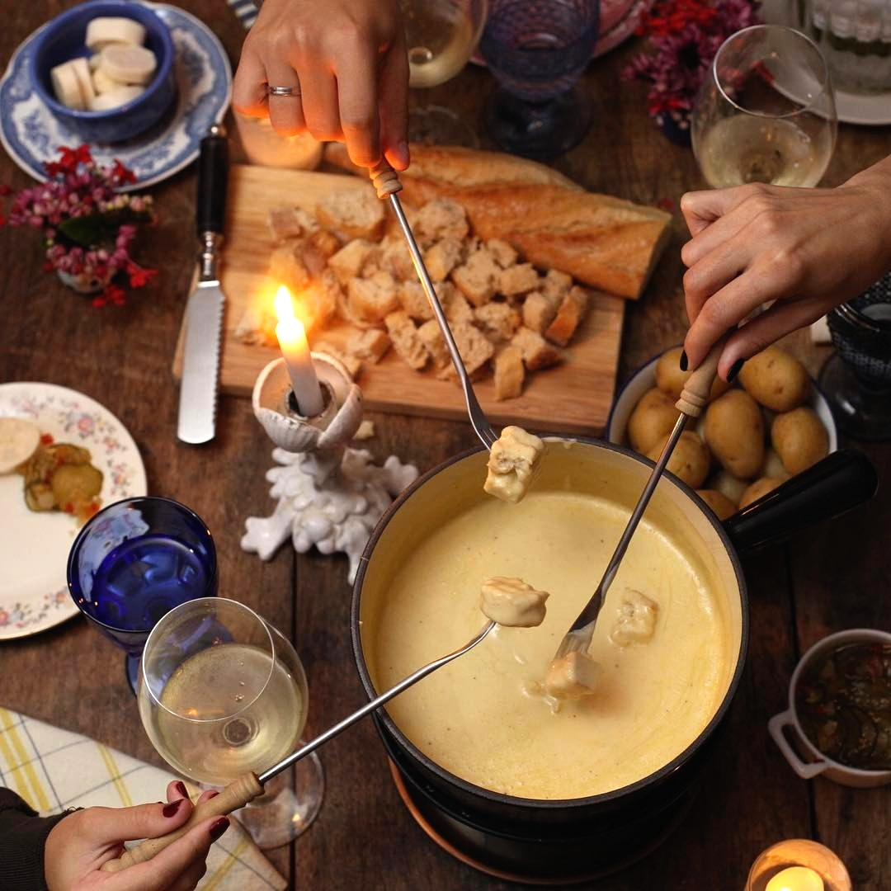 | 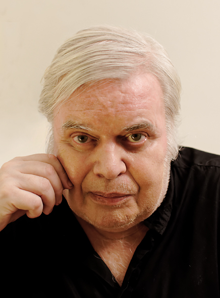 |

* **Что смотрим**: Сказочный укрепленный замок XIII века, венчающий вершину отдельного холма среди альпийских холмов. Полностью пешеходная мощеная улочка внутри крепостных стен, вывески ремесленников, традиционные таверны.
* **Гастрономия**: В Грюйере делают классическое фондю **«Moitié-Moitié» (50 на 50)**: половина выдержанного сыра *Gruyère AOP* и половина сливочного *Vacherin Fribourgeois* с белым вином и чесноком.
* **Музей «Чужого» (H.R. Giger)**: Посреди средневекового городка открыт официальный музей и бар Ханса Рудольфа Гигера — швейцарского сюрреалиста, придумавшего монстра Чужого. Своды и стулья бара сделаны из биомеханических скелетов.
* **🅿️ Парковка**: **Parking Ville de Gruyères (P1 / P2)** прямо у подножия холма.
* **Время на остановку**: 1.5 часа (прогулка + обед).

---

### 8. Château de Chillon & Montreux
`[ТРАССА A9 У ВОДЫ LAC LÉMAN • 145 КМ]`

#### 📸 Галерея точки:
| Каменный замок Chillon прямо в воде | Пальмовая набережная Montreux |
| :---: | :---: |
| 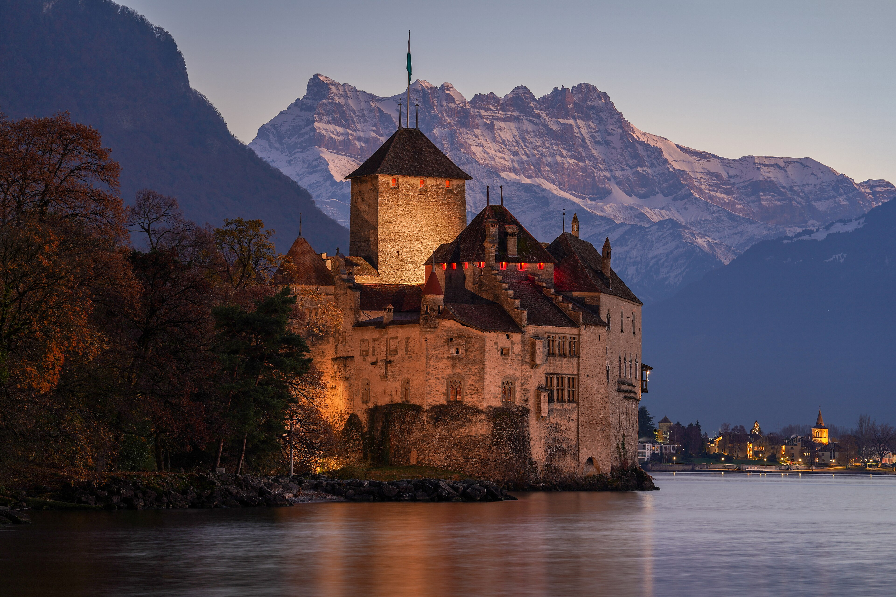 | 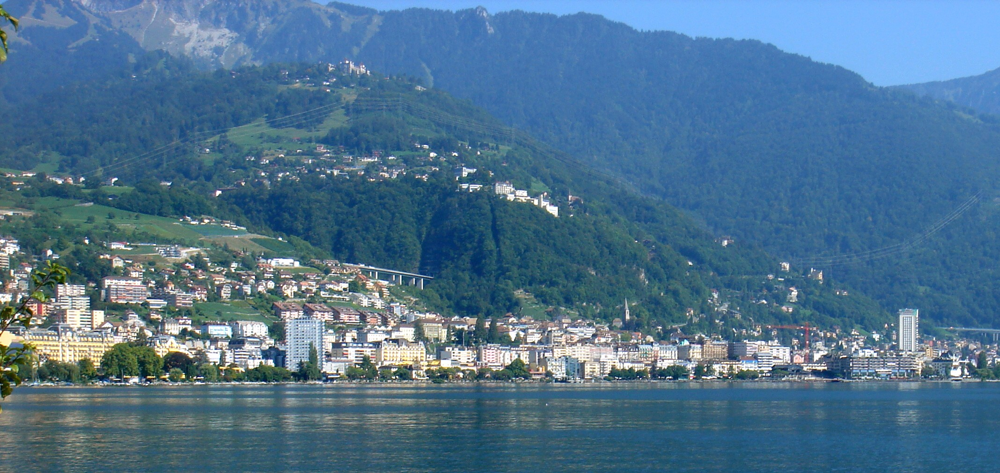 |

* **Что смотрим**: Каменный замок на скальном острове прямо в бирюзовой глади Женевского озера (*Lac Léman*). Позади замка стеной поднимаются заснеженные хребты Dents du Midi.
* **📜 Байрон и Франкенштейн**: В «Год без лета» (1816 г.) лорд Байрон приплыл в замок, вырезал на третьей колонне подземелья свое имя *Byron* (автограф виден до сих пор) и написал поэму «Шильонский узник», а 18-летняя Мэри Шелли на соседней вилле сочинила «Франкенштейна».
* **Набережная Montreux (в 3 км)**: Пальмы на фоне заснеженных Альп и 3-метровый бронзовый памятник Фредди Меркьюри у самой воды.
* **🅿️ Парковка**: Карманы вдоль набережной **Avenue de Chillon** прямо перед замком.
* **Время на остановку**: 45 минут.

---

### 9. Chamonix-Mont-Blanc
`[ФИНИШНАЯ ТОЧКА ЭТАПА 3 • ВЫСОТА 1 035 М]`

#### 📸 Галерея точки:
| Mont Blanc (4 808 м) над крышами города | Скальная игла Aiguille du Midi (3 842 м) |
| :---: | :---: |
|  | 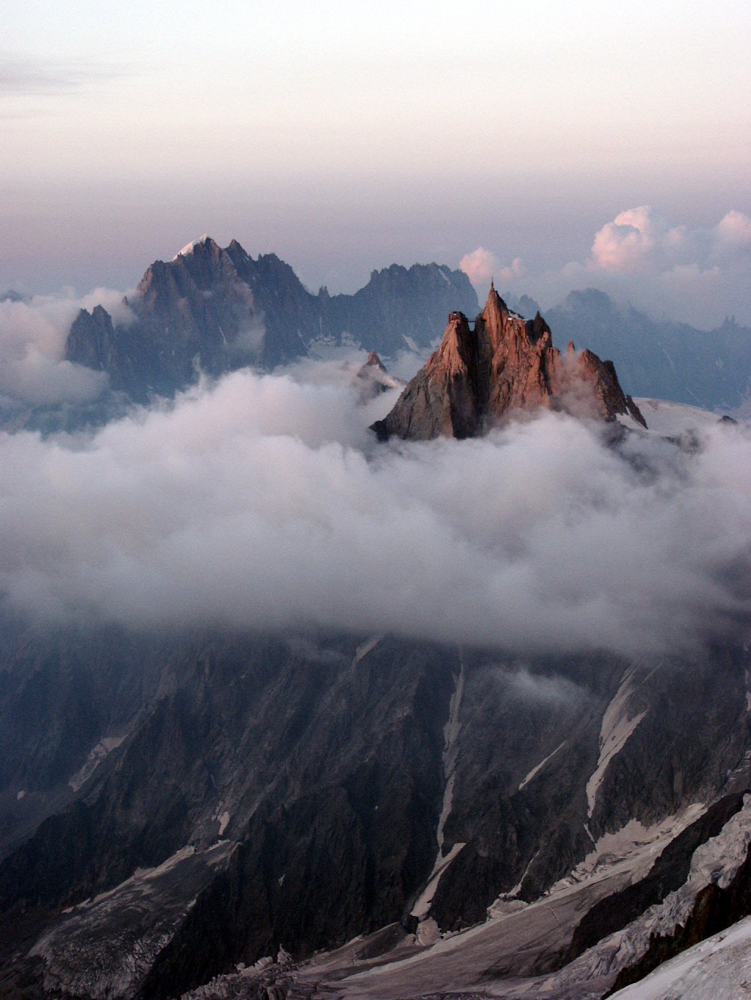 |

* **Что смотрим**: Мировая столица альпинизма на высоте 1 035 м. Прямо над крышами города на 3.8 километра в небо взлетает ледяной купол **Mont Blanc (4 808 м)** — высшей точки Европы. Рядом с городом спускается ледник *Glacier des Bossons*.
* **📜 История**: До 1786 года горы называли «Проклятыми», веря в драконов. В 1786 году Жак Бальма и Мишель Паккар впервые взошли на вершину, начав эру альпинизма. В 1924 году здесь прошли I Зимние Олимпийские игры.
* **Канатная дорога Aiguille du Midi (3 842 м)**: Подъем на скальную иглу со стеклянной кабиной над километровой пропастью.
* **🅿️ Безопасная парковка**: **Parking Saint-Michel** (крытый охраняемый подземный гараж в центре Chamonix — идеален для сохранности вещей при переезде).
* **Вечер**: Савойский горячий **Tartiflette** (картофель с беконом и расплавленным сыром Реблошон) и прогулка по пешеходной Rue du Docteur Paccard.

---

## ❄️ Зимний навигационный совет (Этап 3)
* **Надежный выбор (A40)**: Едем по 4-полосной *Autoroute Blanche* через Женеву. Полотно греется, спецтехника чистит дорогу круглосуточно. Подъем плавный и безопасный.
* **Перевал Col de la Forclaz (1 527 м)**: Срезает 70 км, но это крутой альпийский серпантин. Сворачиваем только при идеальном чистом голубом небе. При осадках — только A40.
